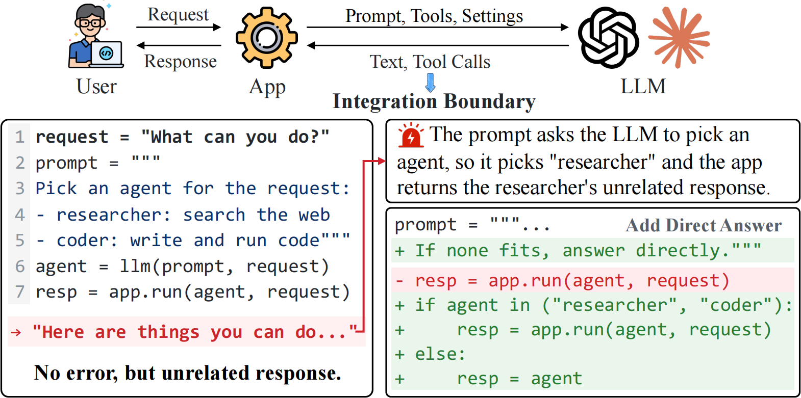
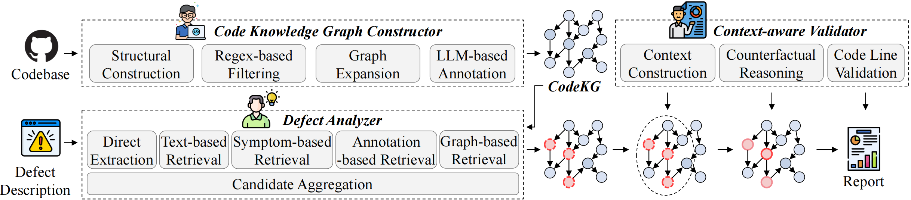
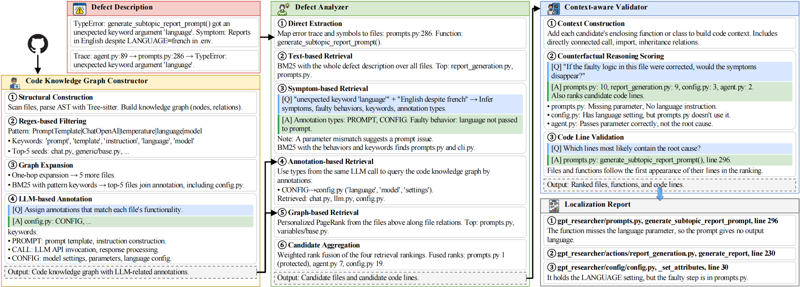

# LIDL: LLM Integration Defect Localization via Knowledge Graph-Enhanced Multi-Agent Analysis


**LIDL is a multi-agent framework for defect localization in LLM-integrated software, combining a code knowledge graph, multi-source evidence fusion, and counterfactual validation.**


## Framework

1. **Code Knowledge Graph Constructor**: Constructs a code knowledge graph enriched with LLM-related annotations across source code, prompts, and configuration files.
2. **Defect Analyzer**: Fuses evidence from direct extraction, text-based retrieval, symptom-based retrieval, annotation-based retrieval, and graph-based retrieval to identify candidate defect locations.
3. **Context-aware Validator**: Applies counterfactual reasoning to distinguish true root causes from propagated symptoms and rank candidate defect locations.




## Quick Start

### Installation

Requirements: [uv](https://docs.astral.sh/uv/) and [Docker](https://www.docker.com/)

```bash
cd LIDL
uv sync --frozen

# Create scripts/.env and configure your API credentials
cp scripts/.env.example scripts/.env
```

```dotenv
LLM_BASE_URL=https://your-provider.example/v1
LLM_API_KEY=YOUR_API_KEY
LLM_MODEL=openai/gpt-5.6-terra
EMBEDDING_BASE_URL=https://your-embedding-provider.example/v1
EMBEDDING_API_KEY=YOUR_EMBEDDING_KEY
EMBEDDING_MODEL=bge-m3
```

## Experiments

```bash
# Dataset
# Option 1: Prepare the dataset using CSV and GitHub
uv run python scripts/prepare_dataset.py --csv datasets/lidl_dataset.csv --root .
# Option 2: Prepare the dataset using CSV and a local ZIP
uv run python scripts/prepare_dataset.py --csv datasets/lidl_dataset.csv --repo-zip datasets_lidl.zip --root .

# RQ1: Localization Effectiveness
uv run python scripts/run_sweagent_all.py
uv run python scripts/run_agentless_all.py
uv run python scripts/run_autocoderover_all.py
uv run python scripts/run_sweagent_repograph_all.py
uv run python scripts/run_agentless_repograph_all.py
uv run python scripts/run_locagent_all.py
uv run python scripts/run_codex_all.py
uv run python scripts/run_main_all.py
# Extract localization results and token usage
uv run python scripts/paper_results.py extract --max-workers 1
# Aggregate file-, function-, and line-level metrics
uv run python scripts/paper_results.py statistics
# Generate the main comparison table
uv run python -c "from pathlib import Path; import sys; sys.path.insert(0, 'scripts'); from paper_result_tables import build_performance_table; p=Path('results/paper_results'); build_performance_table(p/'statistics.csv', p)"
# Generate GPT category comparisons, Venn diagrams, category distributions, and reasoning comparisons
uv run python scripts/paper_result_figures.py --model gpt-5.6-terra

# RQ2: Token and Cost Comparison Using RQ1 Statistics
uv run python scripts/paper_cost_accuracy.py

# RQ3: Ablation Study
# 1. Remove each retrieval component and recompute localization results
uv run python scripts/paper_retrieval_ablation.py --extended --model gpt-5.6-terra --max-workers 1 --resume
# 2. Compute ablation metrics
uv run python scripts/paper_retrieval_ablation.py --extended --model gpt-5.6-terra --shortlist-from results/paper_results/ablation_runs/gpt-5.6-terra/independent_channels --max-workers 1 --resume
# 3. Filter predictions in non-code files
uv run python scripts/paper_retrieval_ablation.py --model gpt-5.6-terra --final-code-only --resume

# RQ4: Downstream Repair Effectiveness
# 1. Generate patches from GPT localization results
uv run python scripts/run_repair_all.py --max-workers 1
# 2. Run tests to evaluate generated patches
uv run python scripts/paper_result_repair.py evaluate --max-workers 1
# 3. Generate the patch comparison report
uv run python scripts/paper_result_repair.py extract
```

## Performance under Different Fusion Weights

Base weights are listed in the order of symptom-based, annotation-based, text-based, and graph-based retrieval. Bold scores indicate the highest value in each metric.

| Base weights | File Top-1 | File Top-3 | File Top-5 | File MAP | File MRR |
| --- | ---: | ---: | ---: | ---: | ---: |
| (1,1,1,1) | **0.3333** | 0.5333 | 0.7000 | 0.4823 | 0.4886 |
| (1,1,1,2) | **0.3333** | 0.5333 | 0.7000 | 0.4849 | 0.4890 |
| (1,1,2,1) | 0.3000 | 0.5000 | 0.7000 | 0.4522 | 0.4596 |
| (1,1,2,2) | 0.3000 | 0.5000 | 0.7000 | 0.4575 | 0.4658 |
| (1,2,1,1) | **0.3333** | 0.5333 | 0.6667 | 0.4790 | 0.4824 |
| (1,2,1,2) | **0.3333** | 0.5333 | 0.6667 | 0.4770 | 0.4808 |
| (1,2,2,1) | 0.3000 | 0.5333 | 0.6667 | 0.4470 | 0.4539 |
| (1,2,2,2) | 0.3000 | 0.5333 | 0.6667 | 0.4561 | 0.4611 |
| (2,1,1,1) | **0.3333** | **0.5667** | 0.7000 | **0.4856** | **0.4925** |
| (2,1,1,2) | **0.3333** | 0.5333 | **0.7333** | 0.4831 | 0.4900 |
| (2,1,2,1) | **0.3333** | 0.5333 | **0.7333** | 0.4744 | 0.4811 |
| **(2,1,2,2) (Selected)** | **0.3333** | 0.5333 | **0.7333** | 0.4748 | 0.4823 |
| (2,2,1,1) | **0.3333** | 0.5333 | 0.6667 | 0.4779 | 0.4841 |
| (2,2,1,2) | **0.3333** | 0.5333 | 0.6667 | 0.4783 | 0.4821 |
| (2,2,2,1) | **0.3333** | 0.5333 | 0.6667 | 0.4727 | 0.4788 |
| (2,2,2,2) | **0.3333** | 0.5333 | 0.6667 | 0.4735 | 0.4799 |

## Citation

If you use LIDL in your research, please cite our paper:

```bibtex
@article{Tan2026LIDL,
  author       = {Gou Tan and
                  Zilong He and
                  Min Li and
                  Pengfei Chen and
                  Jieke Shi and
                  Zhensu Sun and
                  Ting Zhang and
                  Danwen Chen and
                  Lwin Khin Shar and
                  Chuanfu Zhang and
                  David Lo},
  title        = {{LIDL:} {LLM} Integration Defect Localization via Knowledge Graph-Enhanced
                  Multi-Agent Analysis},
  journal      = {CoRR},
  volume       = {abs/2601.05539},
  year         = {2026},
  url          = {https://doi.org/10.48550/arXiv.2601.05539},
  doi          = {10.48550/ARXIV.2601.05539},
  eprinttype   = {arXiv},
  eprint       = {2601.05539},
}
```

## License

[LICENSE](LICENSE).